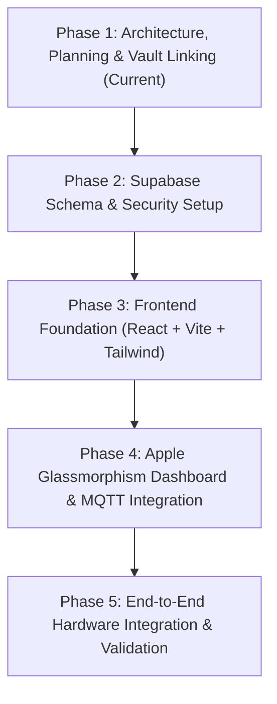

# PawStation Implementation Plan & Roadmap

Part of [[Index]] | Related: [[Security Architecture and Hardening]] | [[Design System and Apple UI]] | [[Supabase and Backend Architecture]] | [[Pawstation Documentation and Parts]]

## 1. Project Analysis & Current State

PawStation is an integrated IoT pet feeder, water dispenser, and digital weighing scale built around an ESP32 microcontroller, a HiveMQ Cloud MQTT broker, a [[Supabase and Backend Architecture|Supabase Backend]], and a client-facing web application.

### Current Inventory
- **Hardware & Firmware Specs:** Complete bill of materials, circuit diagram, pinouts, and calibration instructions documented in [[Pawstation Documentation and Parts]].
- **Security Posture:** Formalized in [[Security Architecture and Hardening]] utilizing backend security best practices, STRIDE threat modeling, and Supabase RLS.
- **Design Language:** Documented in [[Design System and Apple UI]], combining Apple macOS/iOS HIG precision (spring physics, frosted glass, SF Pro typography) with the warm visual cues of the provided reference mockups.
- **Backend Schema:** PostgreSQL schemas, tables, and subscription patterns defined in [[Supabase and Backend Architecture]].
- **Configuration:** Initialized `.env.example`, `.env`, and `.gitignore` to prevent credential exposure.

---

## 2. Phased Implementation Plan

### Phase 1: Planning, Schema & Obsidian Graph Linking (Current Step)
- [x] Complete system analysis and documentation.
- [x] Create comprehensive security guide with STRIDE matrix & RLS policies.
- [x] Create Apple-grade UI/UX design specifications utilizing reference layout inspirations.
- [x] Define Supabase backend schema and real-time event patterns.
- [x] Create root `.env` and `.gitignore` for security isolation.
- [x] Connect all Obsidian notes with bidirectional `[[links]]` for Graph View visualization.
- [x] Stack confirmed: **Next.js + Framer Motion + @supabase/supabase-js + @supabase/ssr**.
- [x] Supabase CLI initialized and linked to project `ztwmlfdyllevyxbgzokd`.
- [x] Supabase agent skills (`supabase`, `supabase-postgres-best-practices`) installed.

### Phase 2: Supabase Schema & Broker Provisioning
- [x] Provision project `ztwmlfdyllevyxbgzokd` and configure `.env`.
- [ ] Run migration script in Supabase to create `stations`, `telemetry_logs`, `feeding_events`, `cat_visits`, and `station_alerts`.
- [ ] Enable Row Level Security (RLS) policies and test role access.
- [ ] Provision HiveMQ Cloud access credentials (`esp32` and `pawstation-web`) with topic isolation.

### Phase 3: Frontend Project Foundation
- [x] Core dependencies installed (`next`, `react`, `react-dom`, `framer-motion`, `@supabase/supabase-js`, `@supabase/ssr`).
- [ ] Configure Apple HIG typography (`SF Pro` font stack) and translucent glassmorphism utility classes (`backdrop-blur`, specular borders).
- [ ] Set up state management and routing.
- [ ] Configure Supabase client and SSR middleware (`@supabase/ssr`).

### Phase 4: Apple Glassmorphic Dashboard & Real-Time Controls
- Implement macOS Floating Glass Header with live connection status pill.
- Build Apple Health/Home-style live telemetry tiles:
  - **Scale Tile:** Animated numeric odometer + spring weight gauge.
  - **Water Reservoir Tile:** Dynamic SVG liquid wave height + low water warning badge.
  - **Cat Visits Tile:** Today's visit counter + last visit timestamp.
- Build Apple Control Center Action Bar:
  - **Dispense Food:** Amber spring button with duration timer.
  - **Run Pump:** Teal button with 3-second countdown ring.
  - **Zero Scale:** Tare button with haptic-like animation.
- Implement Foundation Footer inspired by Reference Image 2: dark obsidian glass canvas with radiant pastel paw motif and system telemetry status.

### Phase 5: Hardware-in-the-Loop Testing & Commissioning
- Verify MQTT connection between ESP32 and HiveMQ over TLS port 8883.
- Verify WebSocket connection from web client over TLS port 8884.
- Test command execution latency and fail-safe lockouts (motor overload prevention, pump dry-run cutoff).
- Perform end-to-end user acceptance testing on desktop and mobile Safari.

---

## 3. Decisions & Checkpoints for User Approval

Before writing application code, please review and confirm:
1. **Frontend Framework:** Confirm **React 18 + Vite + Tailwind CSS + Framer Motion** matches your preferred development environment.
2. **Supabase Setup:** Confirm whether your Supabase project is already created or if you'd like us to provide the ready-to-run SQL migration script.
3. **HiveMQ Cloud Cluster:** Confirm if you already have the cluster hostname ready to populate in `.env`.

---
[[Index]] | [[Security Architecture and Hardening]] | [[Design System and Apple UI]] | [[Supabase and Backend Architecture]] | [[Pawstation Documentation and Parts]]

