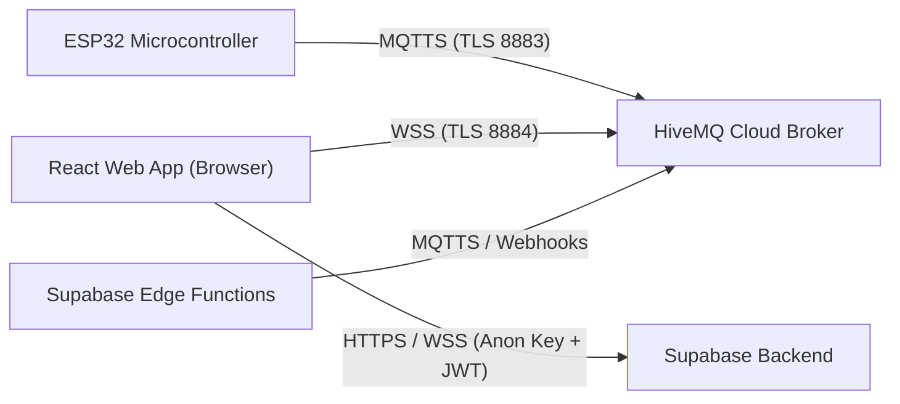

# PawStation Security Architecture & Hardening Guide

Part of [[Index]] | Related: [[Fynsec UI and Landing Page Architecture]] | [[Supabase and Backend Architecture]] | [[Pawstation Documentation and Parts]] | [[Implementation Plan and Roadmap]]

## 1. Threat Modeling & Scope

PawStation is an Internet-of-Things (IoT) ecosystem connecting an ESP32 hardware device (actuators, load cell, water sensor), a HiveMQ Cloud MQTT Broker, a [[Supabase and Backend Architecture|Supabase Backend]] (PostgreSQL, Auth, RLS, Edge Functions), and a client-facing React web application.



### STRIDE Threat Matrix

| Threat Category | Target | Vector / Vulnerability | Mitigation Strategy |
| :--- | :--- | :--- | :--- |
| **Spoofing** | MQTT Broker / Supabase | Attacker claims to be station or authorized user | Distinct client credentials; HiveMQ topic authorization; Supabase JWT authentication |
| **Tampering** | Command & Telemetry stream | Injection of rogue commands (`dispense`, `pump`, `tare`) or falsified scale readings | Payload validation, strict enum allowlists, rate limiting, TLS in transit |
| **Repudiation** | Actuator operations | Dispensing food or water without audit trail | Structured append-only audit logs in Supabase `command_audit_log` with user UUID and timestamp |
| **Information Disclosure** | Credentials & Telemetry | Leaking broker passwords, API keys, or cat behavioral patterns | Strict separation of public anon keys vs service keys; `.env` git exclusion; least-privilege topic rules |
| **Denial of Service** | Physical Actuators | Rapid command flooding causing servo burn, motor stall, or water flood | Firmware-level state locks & timeouts; Supabase rate limiting; Web UI button debouncing |
| **Elevation of Privilege** | Database | Malicious client altering feeding schedules or accessing other stations | PostgreSQL Row Level Security (RLS) policies enforcing user isolation |

---

## 2. Supabase Backend Security & Row Level Security (RLS)

Following backend security best practices, the database is locked down by default. No client can access or manipulate tables unless explicitly permitted through Row Level Security (RLS) policies.

### 2.1 Defense-in-Depth Table Security

```sql
-- 1. Ensure RLS is enabled on all tables
ALTER TABLE public.stations ENABLE ROW LEVEL SECURITY;
ALTER TABLE public.telemetry_logs ENABLE ROW LEVEL SECURITY;
ALTER TABLE public.feeding_events ENABLE ROW LEVEL SECURITY;
ALTER TABLE public.cat_visits ENABLE ROW LEVEL SECURITY;
ALTER TABLE public.station_alerts ENABLE ROW LEVEL SECURITY;
ALTER TABLE public.command_audit_log ENABLE ROW LEVEL SECURITY;

-- 2. Revoke default public schema grants
REVOKE ALL ON ALL TABLES IN SCHEMA public FROM anon, authenticated;
GRANT SELECT, INSERT, UPDATE, DELETE ON ALL TABLES IN SCHEMA public TO authenticated;
GRANT SELECT ON ALL TABLES IN SCHEMA public TO anon; -- Only if public dashboard viewing is permitted
```

### 2.2 Row Level Security (RLS) Policies

```sql
-- Allow users to only view and manage their own stations
CREATE POLICY "Users can access their own stations"
ON public.stations
FOR ALL
TO authenticated
USING (auth.uid() = owner_id)
WITH CHECK (auth.uid() = owner_id);

-- Telemetry logs: Only station owner can read
CREATE POLICY "Station owners can view telemetry"
ON public.telemetry_logs
FOR SELECT
TO authenticated
USING (
  station_id IN (
    SELECT id FROM public.stations WHERE owner_id = auth.uid()
  )
);

-- Command audit log: Append-only by authenticated owners, read-only
CREATE POLICY "Owners can log commands"
ON public.command_audit_log
FOR INSERT
TO authenticated
WITH CHECK (
  auth.uid() = executed_by AND
  station_id IN (SELECT id FROM public.stations WHERE owner_id = auth.uid())
);

CREATE POLICY "Owners can view command history"
ON public.command_audit_log
FOR SELECT
TO authenticated
USING (
  station_id IN (SELECT id FROM public.stations WHERE owner_id = auth.uid())
);
```

### 2.3 Input Validation & Parameterized Queries

- **Constraint Enforcement:** SQL column checks enforce valid telemetry values (e.g., `weight >= -50 AND weight <= 15000`, `water_level >= 0 AND water_level <= 4095`).
- **Command Payloads:** Only strictly allowlisted commands (`dispense`, `pump`, `tare`) can be logged or dispatched:
  ```sql
  ALTER TABLE public.command_audit_log 
  ADD CONSTRAINT valid_command_name 
  CHECK (command_name IN ('dispense', 'pump', 'tare'));
  ```

---

## 3. MQTT Broker & IoT Security Architecture

### 3.1 Credential & Topic Segregation (HiveMQ Cloud)

In a web client environment, frontend assets are public. Embedding administrative credentials into a JavaScript bundle is an critical security vulnerability. 

We implement strict role-based topic authorization:

| Entity | Role / Username | Publish Allowed | Subscribe Allowed | Permitted QoS |
| :--- | :--- | :--- | :--- | :--- |
| **ESP32 Station** | `esp32_device_01` | `pawstation/telemetry`<br>`pawstation/status` | `pawstation/cmd` | QoS 0, 1 |
| **Web Client** | `pawstation_web` | `pawstation/cmd` | `pawstation/telemetry`<br>`pawstation/status` | QoS 0, 1 |
| **Supabase Worker** | `supabase_edge_worker` | `pawstation/cmd` | `pawstation/#` | QoS 1 |

> [!CAUTION]
> The Web Client credential `pawstation_web` is explicitly **denied** permissions to publish to `pawstation/telemetry` or `pawstation/status`. This prevents malicious actors from spoofing false sensor readings or forging station connectivity statuses.

### 3.2 Transport Layer Security (TLS)

- **ESP32 Communication:** All MQTT traffic operates over port **8883** using TLS 1.2/1.3. For production deployments, embed HiveMQ's Root CA (ISRG Root X1 / Let's Encrypt) to verify the broker's identity and defeat Man-in-the-Middle (MitM) attacks.
- **Browser Communication:** The web dashboard connects using secure WebSockets (`wss://<cluster-id>.s1.eu.hivemq.cloud:8884/mqtt`). Plain WebSocket (`ws://`) connections are rejected.

---

## 4. Hardware Fail-Safe & Anti-Abuse Defenses

Firmware-level protections prevent hardware destruction or safety hazards to pets regardless of network commands:

1. **Pump Runaway Prevention:**
   - Maximum continuous pump run is strictly capped in firmware at 3,000 ms (3 seconds), followed by a 600 ms soft-stop.
   - Even if duplicate `pump` commands arrive over MQTT, firmware ignores invocations while a cycle is active.
   - Water level threshold check: if `waterLow == true`, the pump triggers a safety lockout to prevent motor burnout from running dry.
2. **Servo Overheat Mitigation:**
   - Feeder disc actuation uses constrained angles (`20°` fill, `160°` drop) rather than full `0°-180°` stops to prevent mechanical binding.
   - The servo signal is dynamically detached (`servo.detach()`) immediately following dispense completion.
3. **Electrical Isolation:**
   - Actuators run on an isolated 5V power bus; ESP32 GPIOs interface exclusively via optoisolated or MOSFET driver stages (XY-MOS) with a flyback diode.

---

## 5. Web Client Security (Vite / React)

### 5.1 Environment Variable Hygiene
- All client-accessible secrets must start with `VITE_` and contain **only** public anon keys and restricted topic credentials.
- Service role keys (`SUPABASE_SERVICE_ROLE_KEY`) must **never** be prefixed with `VITE_` or included in frontend client bundles.
- A `.gitignore` file enforces that `.env`, `.env.local`, and related secrets files are never committed to version control.

### 5.2 Content Security Policy (CSP) & HTTP Headers

When deploying to Netlify or Vercel, configure strict security headers in `_headers` or `vercel.json`:

```http
Content-Security-Policy: default-src 'self'; connect-src 'self' https://*.supabase.co wss://*.supabase.co wss://*.hivemq.cloud:8884; img-src 'self' data: https:; script-src 'self'; style-src 'self' 'unsafe-inline'; font-src 'self'; object-src 'none'; frame-ancestors 'none';
X-Frame-Options: DENY
X-Content-Type-Options: nosniff
Referrer-Policy: strict-origin-when-cross-origin
Permissions-Policy: camera=(), microphone=(), geolocation=()
```

---

## 6. Security Verification Checklist

- [ ] `.gitignore` contains `.env`, `.env.local`, and build artifacts.
- [ ] Supabase tables have RLS enabled with granular owner policies.
- [ ] HiveMQ Cloud user permissions are verified and topic-restricted.
- [ ] Client commands are validated with strict allowlists before dispatch.
- [ ] Firmware contains watchdog timers and hardware lockout guards.
- [ ] CSP and HTTPS headers are defined for the production web app.

---
[[Index]] | [[Supabase and Backend Architecture]] | [[Design System and Apple UI]] | [[Implementation Plan and Roadmap]]

