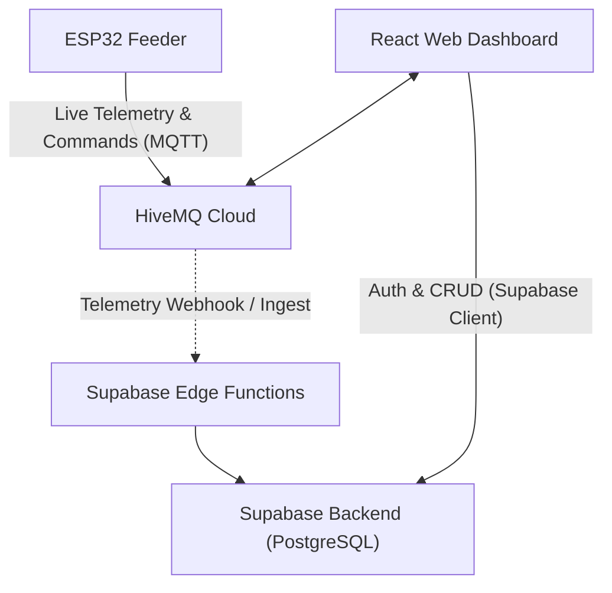

# PawStation Supabase & Backend Architecture

Part of [[Index]] | Related: [[Security Architecture and Hardening]] | [[Design System and Apple UI]] | [[Implementation Plan and Roadmap]]

## 1. Role of Supabase in PawStation

**Linked Supabase Project Ref:** `ztwmlfdyllevyxbgzokd`  
**Endpoint:** `https://ztwmlfdyllevyxbgzokd.supabase.co`

PawStation uses a hybrid architecture:
1. **Low-Latency Live Control:** Direct MQTT over Secure WebSockets (`wss://`) between the browser and HiveMQ Cloud for immediate (sub-100ms) commands (`dispense`, `pump`, `tare`) and 1 Hz live telemetry.
2. **State Persistence & History (Supabase):** PostgreSQL database for storing feeding histories, cat visit timelines, water refilling events, device metadata, user authentication, and threshold configurations.
3. **Next.js SSR & Client Integration:** Utilizing `@supabase/ssr` with cookie-based session handling and client-side real-time channels.



---

## 2. Relational Database Schema

### 2.1 Table Definitions (PostgreSQL DDL)

```sql
-- Enable UUID extension
CREATE EXTENSION IF NOT EXISTS "uuid-ossp";

-- 1. Stations (Hardware Device Registry)
CREATE TABLE public.stations (
    id UUID PRIMARY KEY DEFAULT uuid_generate_v4(),
    created_at TIMESTAMPTZ NOT NULL DEFAULT timezone('utc'::text, now()),
    owner_id UUID REFERENCES auth.users(id) ON DELETE CASCADE,
    device_name TEXT NOT NULL DEFAULT 'PawStation Unit 1',
    broker_client_id TEXT NOT NULL UNIQUE,
    low_water_threshold INT NOT NULL DEFAULT 1500,
    cat_weight_threshold_g NUMERIC(6, 2) NOT NULL DEFAULT 500.0,
    dispense_portion_duration_ms INT NOT NULL DEFAULT 1200,
    is_online BOOLEAN NOT NULL DEFAULT false,
    last_seen_at TIMESTAMPTZ
);

-- 2. Telemetry Logs (Historical Trend Tracking)
CREATE TABLE public.telemetry_logs (
    id BIGINT GENERATED ALWAYS AS IDENTITY PRIMARY KEY,
    station_id UUID NOT NULL REFERENCES public.stations(id) ON DELETE CASCADE,
    recorded_at TIMESTAMPTZ NOT NULL DEFAULT timezone('utc'::text, now()),
    weight_g NUMERIC(6, 2) NOT NULL,
    scale_ok BOOLEAN NOT NULL DEFAULT true,
    cat_present BOOLEAN NOT NULL DEFAULT false,
    water_raw INT NOT NULL,
    water_low BOOLEAN NOT NULL DEFAULT false,
    wifi_rssi INT,
    pump_state TEXT CHECK (pump_state IN ('OFF', 'RUNNING', 'STOPPING'))
);

-- Create hypertable/index on recorded_at for fast time-series queries
CREATE INDEX idx_telemetry_station_time ON public.telemetry_logs (station_id, recorded_at DESC);

-- 3. Feeding Events (Audit of Every Dispense)
CREATE TABLE public.feeding_events (
    id UUID PRIMARY KEY DEFAULT uuid_generate_v4(),
    station_id UUID NOT NULL REFERENCES public.stations(id) ON DELETE CASCADE,
    triggered_at TIMESTAMPTZ NOT NULL DEFAULT timezone('utc'::text, now()),
    trigger_type TEXT NOT NULL CHECK (trigger_type IN ('manual', 'schedule', 'voice')),
    triggered_by UUID REFERENCES auth.users(id),
    status TEXT NOT NULL DEFAULT 'success' CHECK (status IN ('success', 'failed', 'in_progress')),
    portion_count INT NOT NULL DEFAULT 1
);

-- 4. Cat Visits (Weight & Frequency Detection)
CREATE TABLE public.cat_visits (
    id UUID PRIMARY KEY DEFAULT uuid_generate_v4(),
    station_id UUID NOT NULL REFERENCES public.stations(id) ON DELETE CASCADE,
    visit_start TIMESTAMPTZ NOT NULL DEFAULT timezone('utc'::text, now()),
    visit_end TIMESTAMPTZ,
    peak_weight_g NUMERIC(6, 2) NOT NULL,
    duration_seconds INT
);

-- 5. Station Alerts (Notifications & Warnings)
CREATE TABLE public.station_alerts (
    id UUID PRIMARY KEY DEFAULT uuid_generate_v4(),
    station_id UUID NOT NULL REFERENCES public.stations(id) ON DELETE CASCADE,
    created_at TIMESTAMPTZ NOT NULL DEFAULT timezone('utc'::text, now()),
    severity TEXT NOT NULL CHECK (severity IN ('info', 'warning', 'critical')),
    title TEXT NOT NULL,
    message TEXT NOT NULL,
    resolved BOOLEAN NOT NULL DEFAULT false
);
```

---

## 3. Row Level Security (RLS) Implementation

See comprehensive security definitions in [[Security Architecture and Hardening]].

Key rules:
- All tables enforce RLS enabled by default.
- Users can view and modify only records where `station_id` belongs to a station owned by their `auth.uid()`.
- Telemetry ingestion via service-role API or authenticated station tokens.

---

## 4. Realtime Subscriptions

Supabase Realtime is enabled on:
- `public.feeding_events`: Instant visual toast when feeding completes.
- `public.cat_visits`: Live update of today's visit list.
- `public.station_alerts`: Instant alert banners for low water or scale disconnects.

```typescript
// Example Supabase Client Hook
import { createClient } from '@supabase/supabase-js';

const supabase = createClient(
  import.meta.env.VITE_SUPABASE_URL,
  import.meta.env.VITE_SUPABASE_ANON_KEY
);

// Subscribe to feeding events in the dashboard
export const subscribeToFeedings = (stationId: string, onEvent: (event: any) => void) => {
  return supabase
    .channel(`station-feedings-${stationId}`)
    .on(
      'postgres_changes',
      {
        event: 'INSERT',
        schema: 'public',
        table: 'feeding_events',
        filter: `station_id=eq.${stationId}`,
      },
      (payload) => onEvent(payload.new)
    )
    .subscribe();
};
```

---

## 5. Storage & Retention Policies

Because telemetry is published once per second (`1 Hz`), logging every raw tick to Supabase would generate 86,400 rows per day.

### Optimization Strategy:
1. **Live Stream:** Direct browser MQTT subscription (`pawstation/telemetry`) updates the UI at 1 Hz in memory without database writes.
2. **Periodic Snapshot:** Supabase saves a telemetry snapshot once every **5 minutes** (or when a state transition occurs: cat steps on scale, water low detected, food dispensed).
3. **Automatic Purge:** A simple pg_cron task purges raw telemetry snapshots older than 30 days while retaining `cat_visits` and `feeding_events` indefinitely.

---
[[Index]] | [[Security Architecture and Hardening]] | [[Design System and Apple UI]] | [[Implementation Plan and Roadmap]]

